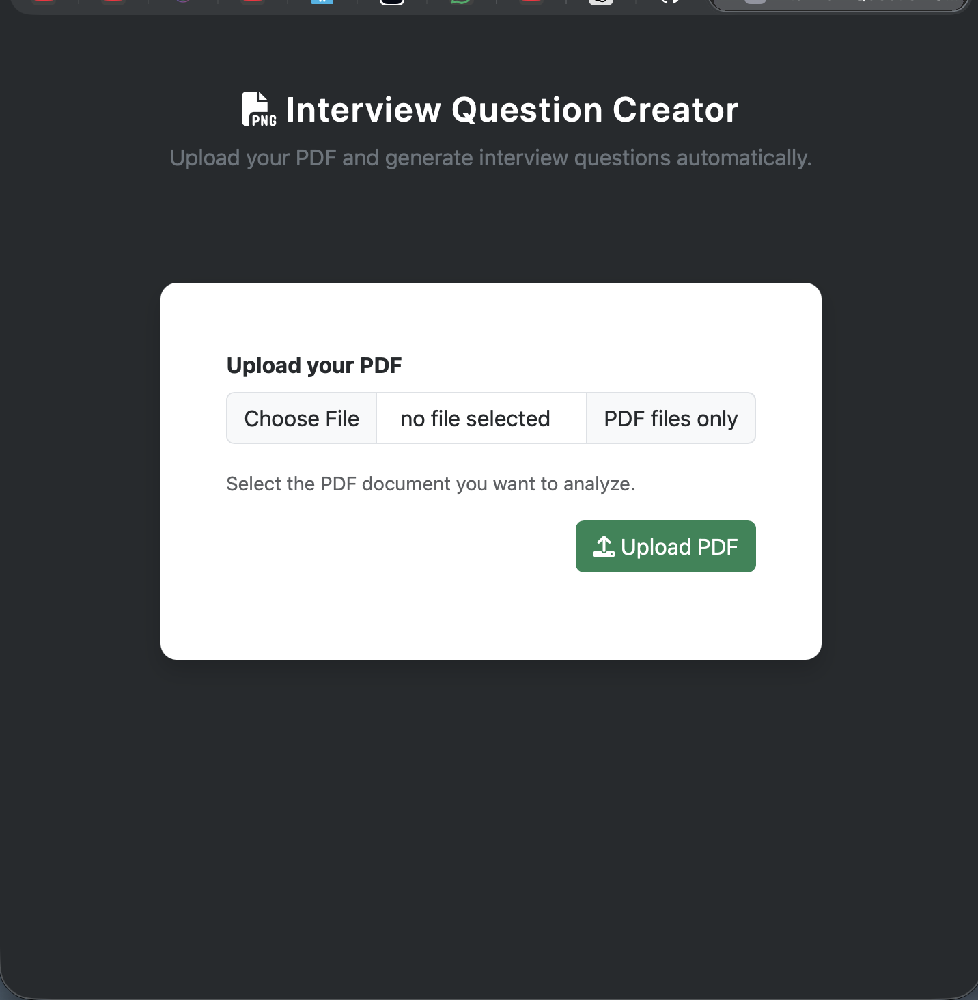
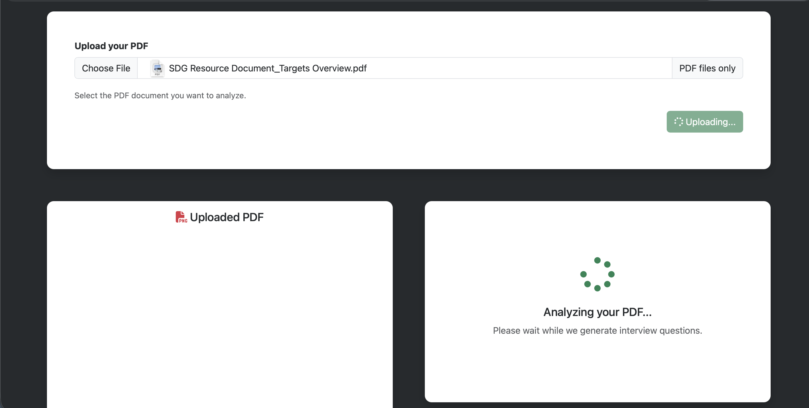
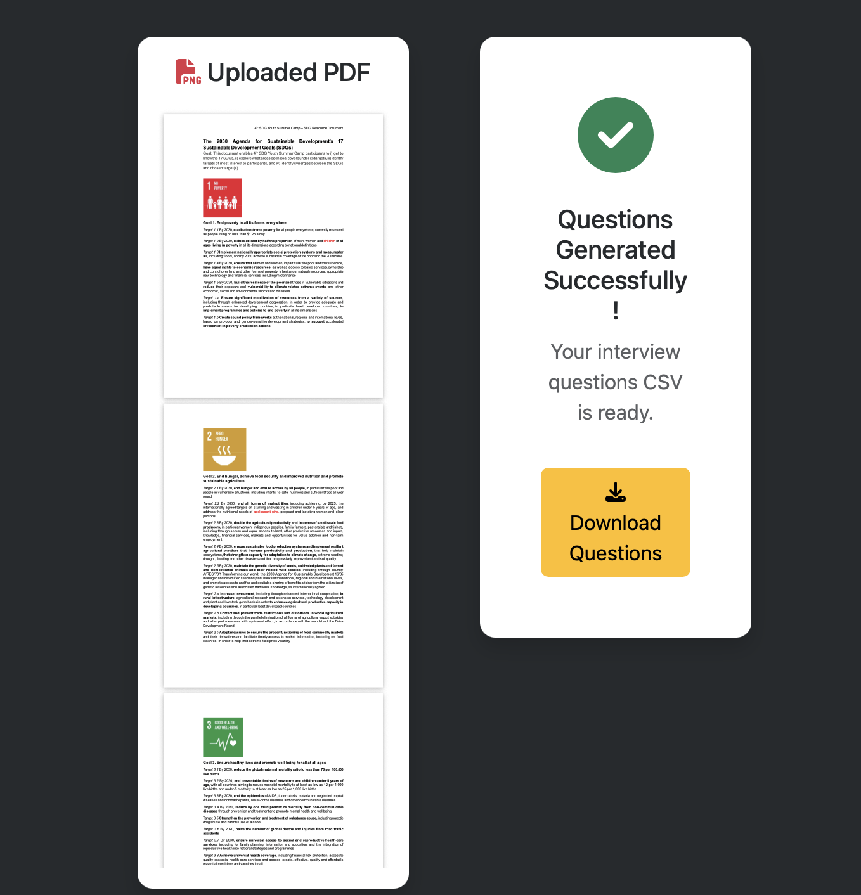
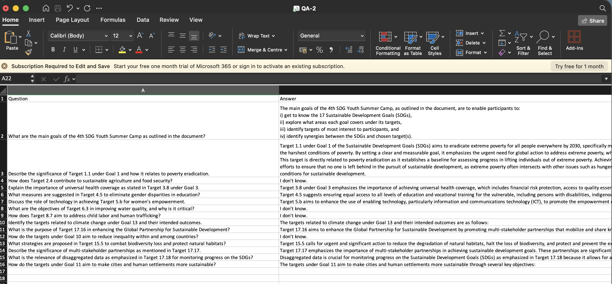

# AI Interview Question Creator

An AI-powered web application that generates technical interview and examination questions from uploaded PDF documents and produces answers grounded in the document content.

The application uses **FastAPI, LangChain, OpenAI GPT-4o-mini, FAISS, and PDF document processing**. A user uploads a PDF through a browser interface. The backend extracts and chunks the document, generates a numbered set of questions, retrieves relevant document passages for each question, and writes the question-answer pairs to a CSV file.

> **Project status:** Core PDF question-generation and question-answering workflow is implemented. Review the limitations and setup notes below before using or deploying the application.

---

## Features

- **PDF upload through a web interface:** Upload a PDF from the browser.
- **PDF text extraction:** Load PDF pages using LangChain's `PyPDFLoader`.
- **Token-based chunking:** Split extracted content into chunks for question generation and answer retrieval.
- **AI question generation:** Use OpenAI's `gpt-4o-mini` model to generate at least 10 conceptual and technical questions based on the document.
- **Question refinement:** Use a LangChain `refine` summarization chain to incorporate additional document context and reduce duplicate questions.
- **Semantic retrieval:** Create embeddings for document chunks using `OpenAIEmbeddings`.
- **FAISS vector search:** Store document embeddings in an in-memory FAISS vector store for retrieval.
- **Context-grounded answers:** Use LangChain `RetrievalQA` to answer each generated question using the top three retrieved chunks.
- **CSV export:** Save generated questions and answers in `static/output/QA.csv`.
- **Browser-based workflow:** Use a simple HTML interface to upload a PDF, view the uploaded document, and initiate analysis.

---

## How It Works

1. The user selects and uploads a PDF through the browser interface.
2. FastAPI receives the uploaded file and saves it under `static/docs/`.
3. `PyPDFLoader` extracts the text from the PDF pages.
4. `TokenTextSplitter` creates chunks for question generation and answer retrieval.
5. A LangChain `refine` chain with `gpt-4o-mini` generates and refines a numbered list of questions from the document.
6. `OpenAIEmbeddings` converts answer-retrieval chunks into vectors.
7. FAISS creates an in-memory vector store from those chunks.
8. For each generated question, `RetrievalQA` retrieves the three most relevant chunks and asks `gpt-4o-mini` to generate an answer.
9. FastAPI writes the question-answer pairs to `static/output/QA.csv`.

---

## Technology Stack

| Component | Technology |
|---|---|
| Language | Python |
| Web framework | FastAPI |
| ASGI server | Uvicorn |
| Frontend | HTML, CSS, JavaScript |
| UI libraries | Bootstrap 5.3.1, jQuery, SweetAlert2, Font Awesome |
| LLM | OpenAI GPT-4o-mini |
| LLM framework | LangChain |
| PDF loading | PyPDFLoader |
| Text splitting | TokenTextSplitter |
| Embeddings | OpenAI Embeddings |
| Vector store | FAISS (`faiss-cpu`) |
| Retrieval QA | LangChain `RetrievalQA` |
| Output | CSV |

---

## Project Structure

```text
project-root/
├── app.py                  # FastAPI application and upload/analyze endpoints
├── setup.py                # Python package setup
├── requirements.txt        # Python dependencies
├── answers.txt             # Output written by the standalone experiment script
├── src/
│   ├── __init__.py
│   ├── helper.py           # PDF processing, question generation and retrieval QA
│   ├── prompt.py           # Question-generation and refinement prompts
│   └── test_helper.py      # PDF-processing smoke-test script
│
├── templates/
│   └── index.html          # Browser interface
│
├── static/
│   ├── docs/               # Uploaded PDF documents
│   └── output/
│       └── QA.csv          # Generated question-answer CSV
│
├── data/                   # Local input documents used by the experiment
├── .env                    # Local API credentials (must not be committed)
├── .env.example            # Safe environment-variable template (recommended)
├── .gitignore
└── README.md
```

The exact contents of `data/`, `static/docs/`, and `static/output/` are local runtime data and should be reviewed before publishing.

---

## Prerequisites

- Python 3.10 or newer (use a Python version compatible with the installed LangChain and FAISS packages).
- An OpenAI API key with access to `gpt-4o-mini` and the embedding model used by `OpenAIEmbeddings`.
- Internet access for OpenAI API requests and dependency installation.

---

## Installation

### 1. Clone the repository

```bash
git clone https://github.com/bhoomireddyvijayakumari/ai-interview-question-creator.git
cd ai-interview-question-creator-agent
```


### 2. Create a virtual environment

**macOS / Linux**

```bash
python3 -m venv .venv
source .venv/bin/activate
```

**Windows PowerShell**

```powershell
py -m venv .venv
.venv\Scripts\Activate.ps1
```

### 3. Install dependencies

```bash
python -m pip install --upgrade pip
python -m pip install -r requirements.txt
```

The dependency list is maintained in `requirements.txt`. If you change LangChain versions, verify that the installed packages provide the imports used in `src/helper.py`, including `langchain_openai`, `langchain_text_splitters`, and `langchain_classic`.

### 4. Configure the OpenAI API key

Create a `.env` file in the project root:

```env
OPENAI_API_KEY=your_openai_api_key_here
```

The application loads environment variables using `python-dotenv`. Keep the real `.env` file private and never commit it.

---

## Run the Web Application

From the project root, with the virtual environment activated:

```bash
uvicorn app:app --reload --host 127.0.0.1 --port 8080
```

Open the application in your browser:

```text
http://127.0.0.1:8080
```

### Using the application

1. Select a PDF using the upload control.
2. Click **Upload PDF**.
3. The application uploads and saves the PDF under `static/docs/`.
4. The browser displays the uploaded PDF and starts the analysis request.
5. The backend generates questions, retrieves document passages, and generates answers.
6. The question-answer pairs are written to `static/output/QA.csv`.

**Output note:** The current FastAPI backend writes a CSV file named `QA.csv`. The provided HTML currently contains text referring to a downloadable PDF, but the backend response points to the CSV file. Update the UI wording and download handling if you want the browser to offer a CSV download accurately.

---

## Question Generation and Answering

### Question generation

The question-generation prompt instructs the model to:

- Generate at least 10 questions.
- Cover important concepts in the document.
- Include conceptual and technical questions.
- Make each question standalone.
- Return numbered questions only, without answers or explanatory text.

A `refine` chain incorporates additional document chunks, preserves relevant questions, adds questions when new context supports them, and removes duplicates.

### Answer generation

The application creates embeddings for the answer-generation chunks and indexes them in FAISS.

For each generated question:

- The retriever searches the FAISS vector store.
- The current retrieval setting requests the top three chunks (`k=3`).
- LangChain's `RetrievalQA` chain passes the retrieved context to the language model.
- The generated answer is paired with its question and written to the CSV output.

---


## Tests and Validation

The file `src/test_helper.py` is currently a smoke-test script that calls `file_processing()` on a configured PDF and prints the number of chunks and a sample of extracted text.

Run it from the project root:

```bash
python -m src.test_helper
```

This requires the configured PDF to exist at the path specified in the test script and a valid OpenAI API key if the imported helper initializes OpenAI-dependent components.

---

## Screenshots








---

## Important Limitations and Notes

- The FAISS vector store is created in memory by the current pipeline. The code shown does not persist the vector index between runs.
- The question-generation and answer-generation steps require OpenAI API access and may incur API usage costs.
- The current web workflow writes a CSV file, not a generated PDF.
- The current `app.py` saves uploaded files using the supplied filename. For production use, add filename sanitization, file-size limits, content validation, and safer upload handling.
- The current application does not show authentication or user-specific document isolation. Do not expose it publicly with sensitive documents in its present form.
- The answer-generation pipeline uses retrieved document chunks, but generated answers should still be checked against the original PDF.
- The standalone experiment script uses a hard-coded input PDF path. Update it if you want to process a different document.

---


